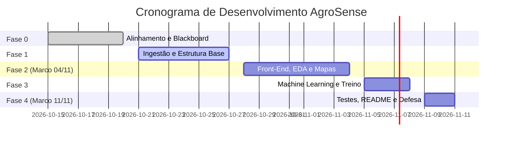

# AgroSense — Sistema Inteligente de Monitoramento Agrícola e Predição de Safra

> **Disciplina:** Tópicos Especiais em Software  
> **Professor:** Prof. Rhafael Freitas da Costa  
> **Entrega Parcial (Apresentação do Front-end):** 04/11 (0,5 ponto)  
> **Entrega Final e Defesa de Código:** 11/11  
> **Equipe de Desenvolvimento:** 5 Desenvolvedores (Dev 1, Dev 2, Dev 3, Dev 4, Dev 5)

---

## 1. Visão Geral do Projeto e Objetivos

O **AgroSense** é uma aplicação web em Python concebida para atuar como uma plataforma de inteligência de dados agronômicos e modelagem preditiva com aprendizado de máquina. O projeto foi projetado para cumprir rigorosamente 100% das exigências do edital:

1. **Upload e Flexibilidade Estrutural:** Importação de bases nos formatos `.csv`, `.json` e `.xml`. A aplicação aceita bases distintas de diferentes safras, culturas e regiões agrícolas (ex.: Mato Grosso, Paraná, Goiás) mantendo o mesmo esquema de colunas, recalculando visualizações e modelos em tempo de execução.
2. **Análise de Dados e Visualização Avançada:** Manipulação e limpeza com `pandas`. Fornece gráficos básicos (barras, rosca/pizza, dispersão, matriz de correlação) e visualização geográfica interativa obrigatória em mapas (Folium/Plotly) com latitude e longitude dos talhões.
3. **Machine Learning e Customização Interativa:** Algoritmos preditivos via `scikit-learn` cobrindo duas frentes:
   - **Regressão:** Estimativa da produtividade em sacas por hectare (`produtividade_sc_ha`).
   - **Classificação:** Estratificação do nível de risco climático de quebra de safra (`risco_quebra`: Baixo, Moderado, Alto).
   - O usuário escolhe na interface entre *Random Forest*, *Decision Tree* e *KNN*, ajustando hiperparâmetros em tempo real através de sliders na barra lateral.
4. **Treinamento Dinâmico (*Retraining Engine*):** Capacidade de re-treinar os modelos imediatamente ao receber novas bases ou novos parâmetros sem reiniciar a aplicação.
5. **Simulador Preditivo em Tempo Real:** Formulário interativo para entrada de variáveis edafoclimáticas de um novo talhão com inferência imediata.

---

## 2. Regras de Negócio e Fórmulas Matemáticas do Domínio

Para que a geração dos dados sintéticos e o comportamento dos modelos tenham rigor e coerência agronômica real, o projeto segue as seguintes regras determinísticas de negócio:

### 2.1. Equação de Produtividade Agrícola (Target de Regressão)
A produtividade esperada ($P$, em sacas de 60 kg por hectare) é modelada a partir de uma base fenológica ponderada por fatores climáticos e de solo:

$$P = 55.0 + f_{\text{chuva}}(\text{precipitacao}) - f_{\text{temp}}(\text{temperatura}) + f_{\text{solo}}(\text{ph}, \text{argila}, \text{umidade}) + \epsilon$$

Onde:
* **Fator Chuva:** $f_{\text{chuva}} = 0.015 \times (\text{precipitacao\_mm} - 600)$, com limite ótimo entre $1200\text{ mm}$ e $1600\text{ mm}$.
* **Penalidade Térmica:** $f_{\text{temp}} = 1.2 \times |\text{temperatura\_media} - 24.0|$. Desvios da faixa ideal ($22\text{ °C}$ a $26\text{ °C}$) reduzem o rendimento.
* **Fator Solo:**
  $$f_{\text{solo}} = 0.12 \times \text{umidade\_solo\_pct} + 3.5 \times (1.0 - |\text{ph\_solo} - 6.2|) + 0.08 \times \text{teor\_argila\_pct}$$
* **Ruído Estocástico:** $\epsilon \sim \mathcal{N}(0, 2.5)$, simulando variações biológicas não controladas.
* **Intervalo Válido:** $0.0 \le P \le 120.0\text{ sc/ha}$.

### 2.2. Regra Determinística de Risco Climático de Quebra (Target de Classificação)
O risco de perda severa de safra (`risco_quebra`) é derivado do Índice de Estresse Hídrico e Térmico ($IEHT$):

$$IEHT = \left( \frac{\max(0, 800 - \text{precipitacao\_mm})}{800} \right) \times 0.45 + \left( \frac{\max(0, \text{temperatura\_media} - 28)}{10} \right) \times 0.35 + \left( \frac{\max(0, 40 - \text{umidade\_solo\_pct})}{40} \right) \times 0.20$$

* Se $IEHT \ge 0.55 \implies \text{risco\_quebra} = \text{\textbf{Alto}}$
* Se $0.25 \le IEHT < 0.55 \implies \text{risco\_quebra} = \text{\textbf{Moderado}}$
* Se $IEHT < 0.25 \implies \text{risco\_quebra} = \text{\textbf{Baixo}}$

---

## 3. Especificação do Esquema de Dados (*Data Schema*)

Todas as bases enviadas pelo usuário (`.csv`, `.json`, `.xml`) devem obrigatoriamente possuir as 13 colunas abaixo estruturadas:

| # | Coluna | Tipo Python | Descrição | Faixa / Domínio | Exemplo |
| :-: | :--- | :--- | :--- | :--- | :--- |
| 1 | `talhao_id` | `str` | Identificador único do lote | String alfanumérica | `"TAL-001"` |
| 2 | `municipio` | `str` | Cidade/região de localização | Texto | `"Sorriso"` |
| 3 | `latitude` | `float` | Latitude geográfica (graus decimais) | $-33.75$ a $5.27$ | `-12.5425` |
| 4 | `longitude` | `float` | Longitude geográfica (graus decimais)| $-73.98$ a $-34.79$ | `-55.7211` |
| 5 | `cultura` | `str` | Espécie vegetal plantada | `Soja`, `Milho`, `Algodão` | `"Soja"` |
| 6 | `area_hectares` | `float` | Área cultivada em hectares | $1.0$ a $5000.0$ | `150.0` |
| 7 | `precipitacao_mm` | `float` | Chuva acumulada no ciclo vegetativo | $0.0$ a $3000.0$ | `1420.5` |
| 8 | `temperatura_media`| `float` | Temperatura média observada (°C) | $10.0$ a $45.0$ | `25.3` |
| 9 | `umidade_solo_pct` | `float` | Umidade volumétrica média do solo (%) | $0.0$ a $100.0$ | `64.2` |
| 10| `ph_solo` | `float` | Potencial hidrogeniônico do solo | $3.5$ a $9.0$ | `6.1` |
| 11| `teor_argila_pct` | `float` | Percentual de argila no solo (%) | $0.0$ a $100.0$ | `48.0` |
| 12| `produtividade_sc_ha`| `float` | Produtividade colhida (sacas/ha) | Target Regressão ($0$ a $120$) | `68.4` |
| 13| `risco_quebra` | `str` | Risco de perda de safra | Target Classificação | `"Baixo"` |

---

## 4. Arquitetura Modular e Contratos Técnicos de Interface

O código do projeto é dividido em módulos com responsabilidades estritas, sem lógica solta no arquivo principal:

```text
ML_AGROSENSE/
├── .gitignore
├── README.md                            # Guia completo do projeto e planejamento
├── requirements.txt                     # Dependências fixadas
├── app.py                               # Interface web principal (Streamlit)
├── data/                                # Bases intercambiáveis de teste
│   ├── safra_soja_mt.csv                # Base padrão CSV (Soja / Mato Grosso)
│   ├── safra_milho_pr.json              # Base intercambiável JSON (Milho / Paraná)
│   └── safra_algodao_go.xml             # Base intercambiável XML (Algodão / Goiás)
├── src/
│   ├── __init__.py
│   ├── config.py                        # Constantes, limites e colunas esperadas
│   ├── data_loader.py                   # Ingestão de arquivos (.csv, .json, .xml)
│   ├── preprocessor.py                  # Imputação, codificação e splits
│   ├── visualizer.py                    # Gráficos Plotly e Mapas Folium
│   ├── ml_engine.py                     # Instanciação, treino e avaliação de modelos
│   └── predictor_service.py             # Re-treinamento dinâmico e inferência
└── tests/
    ├── __init__.py
    ├── test_data_loader.py              # Testes de ingestão e schemas
    └── test_ml_engine.py                # Testes de convergência dos modelos
```

---

### 4.1. Contratos Técnicos por Módulo (Assinaturas e Comportamentos)

#### Módulo: `src/config.py`
Define as constantes consumidas globalmente:
```python
REQUIRED_COLUMNS = [
    "talhao_id", "municipio", "latitude", "longitude", "cultura",
    "area_hectares", "precipitacao_mm", "temperatura_media",
    "umidade_solo_pct", "ph_solo", "teor_argila_pct",
    "produtividade_sc_ha", "risco_quebra"
]

NUMERIC_FEATURES = [
    "area_hectares", "precipitacao_mm", "temperatura_media",
    "umidade_solo_pct", "ph_solo", "teor_argila_pct"
]

CATEGORICAL_FEATURES = ["cultura"]
TARGET_REGRESSION = "produtividade_sc_ha"
TARGET_CLASSIFICATION = "risco_quebra"
CULTURAS_VALIDAS = ["Soja", "Milho", "Algodão"]
RISCO_CLASSES = ["Baixo", "Moderado", "Alto"]
```

#### Módulo: `src/data_loader.py`
Responsável pela leitura e validação estrita dos 3 formatos:
```python
def load_file(uploaded_file) -> pd.DataFrame:
    """
    Lê um arquivo enviado via Streamlit ou caminho em disco (.csv, .json, .xml).
    Retorna um pd.DataFrame padronizado.
    Lança ValueError se o formato for inválido ou o conteúdo estiver corrompido.
    """

def parse_xml_payload(xml_bytes: bytes) -> pd.DataFrame:
    """
    Extrai as tags filhas de cada nó <talhao> e converte para dicionários tabulares.
    Converte colunas numéricas automaticamente.
    """

def validate_schema(df: pd.DataFrame) -> tuple[bool, list[str]]:
    """
    Verifica se todas as colunas de REQUIRED_COLUMNS existem em df.
    Retorna (True, []) se válido, ou (False, ['colunas_faltantes']) se inválido.
    """
```

#### Módulo: `src/preprocessor.py`
Garante a integridade matemática antes do treino:
```python
def clean_dataset(df: pd.DataFrame) -> pd.DataFrame:
    """
    Remove duplicatas, descarta linhas onde os alvos são nulos e aplica
    imputação de mediana para features numéricas ausentes.
    """

def get_preprocessor_pipeline() -> ColumnTransformer:
    """
    Retorna o ColumnTransformer com:
    - StandardScaler para NUMERIC_FEATURES
    - OneHotEncoder(drop='first', handle_unknown='ignore') para CATEGORICAL_FEATURES
    """

def prepare_train_test_data(df: pd.DataFrame, task: str = "regressao", test_size: float = 0.2, random_state: int = 42):
    """
    Separa X e y de acordo com task ('regressao' ou 'classificacao').
    Retorna X_train, X_test, y_train, y_test e o ColumnTransformer ajustado.
    """
```

#### Módulo: `src/visualizer.py`
Renderiza os gráficos estáticos e interativos:
```python
def render_geographic_map(df: pd.DataFrame, color_mode: str = "risco_quebra") -> folium.Map:
    """
    Gera um mapa Folium centrado na média das coordenadas da base.
    Plotagem de CircleMarker para cada talhão com cor definida por:
      - 'risco_quebra': Verde (Baixo), Laranja (Moderado), Vermelho (Alto)
      - 'produtividade_sc_ha': escala contínua (ex.: 'YlGn')
    Inclui popup interativo com dados completos do talhão.
    """

def plot_productivity_by_crop(df: pd.DataFrame) -> go.Figure:
    """Retorna gráfico de barras Plotly com produtividade média por cultura."""

def plot_risk_distribution(df: pd.DataFrame) -> go.Figure:
    """Retorna gráfico de rosca/pizza Plotly com distribuição percentual do risco."""

def plot_correlation_matrix(df: pd.DataFrame) -> go.Figure:
    """Retorna heatmap interativo de correlações de Pearson entre variáveis numéricas."""

def plot_regression_residuals(y_true, y_pred) -> go.Figure:
    """Retorna dispersão de Valores Reais vs. Previstos e histograma de resíduos."""

def plot_confusion_matrix_heatmap(y_true, y_pred, labels: list[str]) -> go.Figure:
    """Retorna matriz de confusão interativa normalizada."""
```

#### Módulo: `src/ml_engine.py`
Instanciação e ajuste dos algoritmos do `scikit-learn`:
```python
def instantiate_model(algorithm_name: str, task: str, hyperparams: dict):
    """
    Retorna a instância do estimador scikit-learn configurada:
    - Random Forest: RandomForestRegressor ou RandomForestClassifier
    - Decision Tree: DecisionTreeRegressor ou DecisionTreeClassifier
    - KNN: KNeighborsRegressor ou KNeighborsClassifier
    Injeta hyperparams como kwargs na instanciação.
    """

def train_and_evaluate(model, X_train, y_train, X_test, y_test, task: str) -> dict:
    """
    Executa o fit do modelo.
    Calcula e retorna um dicionário com:
      - Se regressão: 'r2', 'mae', 'rmse', 'y_pred'
      - Se classificação: 'accuracy', 'f1_weighted', 'confusion_matrix', 'y_pred'
    """
```

#### Módulo: `src/predictor_service.py`
Lógica de predição pontual e re-treinamento dinâmico:
```python
def run_retrain(df: pd.DataFrame, algorithm_name: str, task: str, hyperparams: dict) -> dict:
    """
    Executa o ciclo completo de re-treinamento sem reiniciar a aplicação:
    clean_dataset -> prepare_train_test_data -> instantiate_model -> train_and_evaluate.
    Retorna o modelo treinado, o transformer ajustado e as novas métricas.
    """

def predict_single_talhao(model, transformer, input_data: dict, task: str) -> dict:
    """
    Recebe um dicionário com os atributos de um novo talhão (ex.: umidade, temperatura).
    Aplica o transformer.transform e executa model.predict().
    Retorna o valor previsto formatado e probabilidades (se classificação).
    """
```

---

## 5. Especificação Detalhada da Interface Streamlit (`app.py`)

A interface foi desenhada para operação intuitiva com divisão em **4 Abas Principais** e uma **Barra Lateral de Controle**:

### 5.1. Barra Lateral (*Sidebar*)
* **Seção 1: Fonte de Dados:**
  * Componente: `st.file_uploader("Carregar Dados Agrícolas", type=["csv", "json", "xml"])`.
  * Seletor de Base Padrão: caso nenhum arquivo seja carregado, exibe um rádio para alternar entre as 3 bases sintéticas salvas em `data/` (`Soja MT (CSV)`, `Milho PR (JSON)`, `Algodão GO (XML)`).
* **Seção 2: Configuração de Machine Learning:**
  * Seletor de Tarefa: `st.radio("Objetivo Preditivo", ["Regressão (Produtividade)", "Classificação (Risco)"])`.
  * Seletor de Algoritmo: `st.selectbox("Modelo", ["Random Forest", "Árvore de Decisão", "K-Nearest Neighbors (KNN)"])`.
* **Seção 3: Sliders de Hiperparâmetros Dinâmicos:**
  * *Se Random Forest:*
    * `n_estimators`: `st.slider("Número de Árvores", min_value=10, max_value=300, value=100, step=10)`.
    * `max_depth`: `st.slider("Profundidade Máxima", min_value=2, max_value=25, value=10, step=1)`.
    * `min_samples_split`: `st.slider("Min Amostras Divisão", min_value=2, max_value=10, value=2)`.
  * *Se Decision Tree:*
    * `max_depth`: `st.slider("Profundidade Máxima", min_value=1, max_value=20, value=6, step=1)`.
    * `criterion`: `st.selectbox("Critério", ["squared_error", "absolute_error"] if reg else ["gini", "entropy"])`.
  * *Se KNN:*
    * `n_neighbors`: `st.slider("Número de Vizinhos (K)", min_value=1, max_value=25, value=5, step=1)`.
    * `weights`: `st.selectbox("Pesos", ["uniform", "distance"])`.
    * `metric`: `st.selectbox("Métrica de Distância", ["euclidean", "manhattan"])`.
* **Botão de Ação:** `st.button("⚡ Re-treinar Modelo com Configurações Atuais", use_container_width=True)`.

---

### 5.2. As 4 Abas Principais

#### Aba 1: Carga e Gestão de Dados
1. **Cards de KPI:** Total de talhões monitorados, área total somada (ha), produtividade média histórica e precipitação média.
2. **Visualizador de Tabela:** `st.dataframe` com busca e paginação dos dados carregados.
3. **Resumo Descritivo:** `df.describe()` das variáveis edafoclimáticas e percentual de valores ausentes por coluna.

#### Aba 2: Análise Exploratória e Mapa Geográfico Interativo
1. **Visualização Geográfica Obrigatória:** Mapa Folium renderizado com `st_folium()`.
   * Dropdown para alternar o modo de cor: `Por Classe de Risco` ou `Por Nível de Produtividade`.
   * Filtro por município e por tipo de cultura agrícola.
2. **Gráficos Analíticos:**
   * Gráfico de barras com a produtividade média por cultura.
   * Gráfico de pizza/rosca com a distribuição percentual das classes de risco.
   * Matriz de correlação térmica entre variáveis de solo e clima.
   * Gráfico de dispersão interativo com linha de tendência (Precipitação vs. Produtividade).

#### Aba 3: Painel de Machine Learning e Diagnóstico de Performance
1. **Cards com Métricas de Avaliação no Conjunto de Teste (20% dos dados):**
   * *Se Regressão:* $R^2$ (*Coeficiente de Determinação*), $MAE$ (*Erro Médio Absoluto*), $RMSE$ (*Raiz do Erro Quadrático Médio*).
   * *Se Classificação:* Acurácia Global, $F_1\text{-Score}$ Ponderado, Precisão e Revocação.
2. **Gráficos de Diagnóstico:**
   * *Regressão:* Gráfico de dispersão entre Valores Reais vs. Valores Previstos e histograma de resíduos.
   * *Classificação:* Matriz de Confusão em heatmap interativo com labels normalizados.
3. **Tabela de Auditoria:** Tabela interativa comparando as 10 primeiras previsões do conjunto de testes lado a lado com os valores reais.

#### Aba 4: Simulador do Produtor (Predição em Tempo Real)
Formulário interativo estruturado em duas colunas:
* **Coluna 1 (Características de Campo):**
  * Município e tipo de cultura (`st.selectbox`).
  * Área do talhão em hectares (`st.number_input`).
  * Teor de argila e pH do solo medidos em laboratório (`st.slider`).
* **Coluna 2 (Condições Meteorológicas Previstas):**
  * Precipitação prevista acumulada (`st.slider`).
  * Temperatura média diária esperada (`st.slider`).
  * Nível de umidade retida no solo (`st.slider`).
* **Resultado:** Caixa de destaque visual (`st.metric` estilizada) contendo:
  * Produtividade Estimada (sacas/ha) acompanhada do desvio padrão do modelo.
  * Classificação de Risco Climático (`Baixo`, `Moderado`, `Alto`) com alerta colorido correspondente.

---

### 5.3. Gerenciamento de Estado no Streamlit (`st.session_state`)

Para garantir que a aplicação não reexecute treinamentos desnecessariamente e preserve os modelos após a navegação entre abas, o estado é orquestrado sob as seguintes chaves estritas:

```python
st.session_state["df_raw"]          # pd.DataFrame original carregado
st.session_state["df_clean"]        # pd.DataFrame higienizado sem nulos
st.session_state["model_reg"]       # Instância atual do regressor scikit-learn
st.session_state["model_clf"]       # Instância atual do classificador scikit-learn
st.session_state["transformer_reg"] # ColumnTransformer ajustado para regressão
st.session_state["transformer_clf"] # ColumnTransformer ajustado para classificação
st.session_state["metrics_reg"]     # Dicionário com R2, MAE, RMSE do último treino
st.session_state["metrics_clf"]     # Dicionário com Accuracy, F1 do último treino
st.session_state["data_hash"]       # Hash MD5 do arquivo carregado para detectar trocas de base
```

---

## 6. Plano de Ação Passo a Passo para os 5 Desenvolvedores



### Dev 1: Engenheiro de Dados e Ingestão Multiformato
* **Semana 1:**
  1. Escrever o script gerador de bases sintéticas implementando as fórmulas da Seção 2 e criar os arquivos `data/safra_soja_mt.csv`, `data/safra_milho_pr.json` e `data/safra_algodao_go.xml` (mínimo de 300 linhas cada).
  2. Implementar `src/config.py` com todas as constantes da Seção 4.1.
* **Semana 2:**
  3. Implementar `src/data_loader.py` cobrindo a leitura de `.csv`, `.json` e o parser customizado de `.xml` com tratamento de exceções.
  4. Implementar `validate_schema()` validando as 13 colunas obrigatórias e tipos.
* **Semana 3:**
  5. Testar a flexibilidade intercambiável: alternar arquivos na UI garantindo que nenhum erro de esquema ocorra.
* **Semana 4:**
  6. Redigir a seção de dados do `README.md` e preparar a explicação do código para a arguição do professor.

### Dev 2: Engenheiro de Visualização e Mapas Geoespaciais
* **Semana 1:**
  1. Definir os esquemas de cores no Plotly e paletas do Folium (*Viridis* para produtividade e semafórica para risco).
* **Semana 2:**
  2. Implementar em `src/visualizer.py` as funções `plot_productivity_by_crop()`, `plot_risk_distribution()` e `plot_correlation_matrix()`.
* **Semana 3 (Foco no Marco de 04/11):**
  3. Implementar o mapa geográfico interativo obrigatório `render_geographic_map()` com Folium: renderizar círculos georreferenciados por latitude/longitude, popups informativos e seletor de camada (Risco vs. Produtividade).
  4. Conectar o mapa e os gráficos analíticos à Aba 2 do Streamlit.
* **Semana 4:**
  5. Implementar os gráficos de avaliação do modelo: `plot_regression_residuals()` e `plot_confusion_matrix_heatmap()`.

### Dev 3: Engenheiro de Machine Learning e Modelagem Preditiva
* **Semana 1:**
  1. Definir o pipeline de pré-processamento matemático em `src/preprocessor.py` (`StandardScaler` para numéricas e `OneHotEncoder` para cultura).
* **Semana 2:**
  2. Implementar em `src/ml_engine.py` a fábrica de estimadores `instantiate_model()` suportando *Random Forest*, *Decision Tree* e *KNN* para regressão e classificação.
* **Semana 3:**
  3. Implementar a injeção dinâmica de hiperparâmetros a partir dos dicionários passados pela interface.
  4. Implementar `train_and_evaluate()` com cálculo de $R^2$, $MAE$, $RMSE$, Acurácia e $F_1$-score.
* **Semana 4:**
  5. Executar testes de validação cruzada para garantir que os modelos não apresentem *overfitting* e preparar as justificativas teóricas para a defesa individual.

### Dev 4: Engenheiro de Re-treinamento Dinâmico e Serviços Preditivos
* **Semana 1:**
  1. Configurar o ambiente de testes com `pytest` e criar mocks para validação rápida de código.
* **Semana 2:**
  2. Implementar em `src/predictor_service.py` a função `run_retrain()` garantindo que o re-treino ocorra em memória sem travamento da aplicação.
* **Semana 3:**
  3. Implementar `predict_single_talhao()` realizando a inferência do formulário do simulador.
* **Semana 4:**
  4. Criar testes unitários em `tests/test_data_loader.py` e `tests/test_ml_engine.py`.
  5. Validar a estabilidade do sistema ao receber bases corrompidas ou incompletas, garantindo mensagens amigáveis de erro.

### Dev 5: Arquiteto Front-End, UX/UI e Integração Geral
* **Semana 1:**
  1. Criar o repositório no GitHub, definir branch protection e redigir a mensagem oficial para o Blackboard.
  2. Configurar a casca do Streamlit em `app.py` com layout `wide`.
* **Semana 2:**
  3. Construir a Sidebar com upload de arquivos, seleção de modelos e sliders de hiperparâmetros dinâmicos.
  4. Montar a estrutura das 4 abas e cartões KPI no topo.
* **Semana 3 (Apresentação de 04/11):**
  5. Conectar todos os gráficos de Dev 2 na interface e conduzir o ensaio da equipe para a Apresentação do Front-end (04/11).
* **Semana 4 (Entrega Final de 11/11):**
  6. Ligar o botão de re-treinamento e o simulador interativo às funções de Dev 3 e Dev 4.
  7. Revisar conformidade com PEP 8, realizar o congelamento dos commits (*code freeze*) e coordenar o ensaio da defesa de código.

---

## 7. Roteiro e Tópicos para a Defesa de Código Individual (11/11)

Cada integrante será arguido individualmente pelo professor sobre sua contribuição. Os tópicos que cada um deve dominar estão explicitados na matriz abaixo:

| Desenvolvedor | Arquivo de Foco | Perguntas Prováveis do Professor & Respostas Esperadas |
| :--- | :--- | :--- |
| **Dev 1** | `data_loader.py` / `config.py` | **P: Como você garantiu que o sistema não quebre ao trocar de base?**<br>**R:** "Implementamos a validação de esquema em `validate_schema`, que checa se todas as 13 colunas obrigatórias existem antes de liberar o processamento, unificando os nós de XML e JSON em estruturas compatíveis com o Pandas." |
| **Dev 2** | `visualizer.py` | **P: Como os mapas são atualizados quando o usuário filtra os dados?**<br>**R:** "O método `render_geographic_map` recebe o DataFrame filtrado pelo Streamlit e itera pelas coordenadas de latitude/longitude adicionando marcadores `CircleMarker` dinâmicos com cores condicionadas ao valor da métrica." |
| **Dev 3** | `ml_engine.py` / `preprocessor.py` | **P: Por que o pré-processamento usa ColumnTransformer e como os hiperparâmetros alteram o modelo?**<br>**R:** "O ColumnTransformer evita vazamento de dados (*data leakage*), aplicando StandardScaler nas numéricas e OneHotEncoder na cultura. Os sliders da interface injetam os hiperparâmetros diretamente na instanciação do scikit-learn, controlando a complexidade e evitando overfitting." |
| **Dev 4** | `predictor_service.py` | **P: Como funciona o re-treinamento dinâmico sem reiniciar o servidor?**<br>**R:** "O método `run_retrain` executa o pipeline em memória e sobrescreve as instâncias ativas em `st.session_state`, permitindo que novas inferências usem os pesos recém-calculados imediatamente." |
| **Dev 5** | `app.py` | **P: Qual foi o padrão arquitetural adotado para integrar o front-end ao backend?**<br>**R:** "Adotamos uma arquitetura modular em camadas, onde a UI em Streamlit não possui regras de negócio embutidas; ela apenas consome serviços tipados e gerencia o estado reativo da sessão." |

---

## 8. Guia Rápido de Instalação e Execução

```bash
# 1. Clonar o repositório
git clone https://github.com/[sua-conta]/ML_AGROSENSE.git
cd ML_AGROSENSE

# 2. Criar e ativar o ambiente virtual
python -m venv venv

# Windows:
venv\Scripts\activate
# Linux/macOS:
source venv/bin/activate

# 3. Instalar as dependências estritas
pip install -r requirements.txt

# 4. Iniciar a aplicação web
streamlit run app.py
```
A aplicação iniciará automaticamente no navegador através do endereço `http://localhost:8501`.